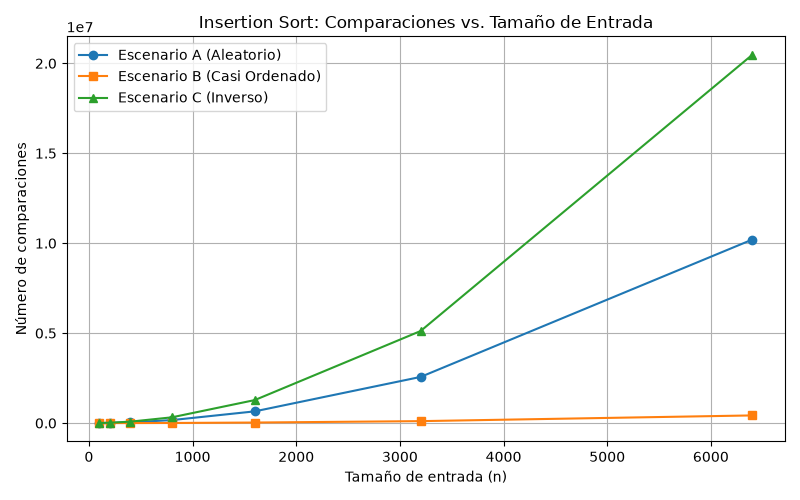
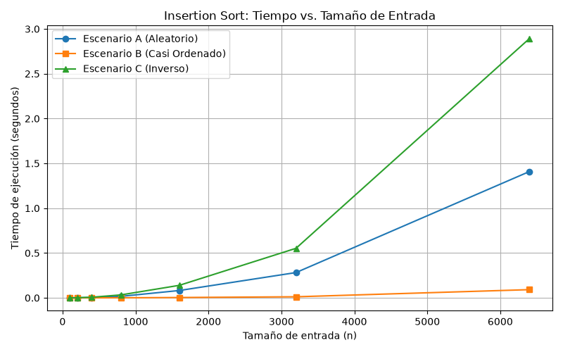
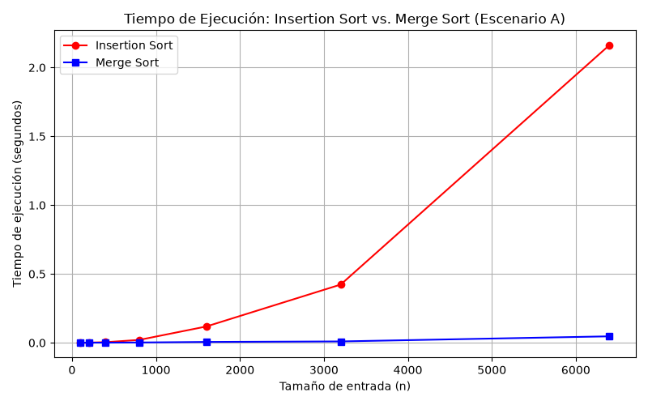

# Laboratorio Evaluativo 01 — Fundamentos, Complejidad y Recurrencias

**Autor:** Cristian Jose Mendez Guzman  
**Fecha:** Septiembre 2026  

---

## Instrucciones de Reproducción

Para ejecutar los experimentos, activar el entorno y regenerar las gráficas, abra la terminal en la carpeta raíz del repositorio y ejecute:

1. **Activar el entorno virtual**: `..\venv\Scripts\activate` (o `source venv/bin/activate` en Unix).
2. **Instalar dependencias**: `pip install -r requirements.txt`
3. **Navegar a la carpeta del laboratorio**: `cd laboratorios/lab1-fundamentos-complejidad-recurrencias`
4. **Ejecutar Parte 3 (Casos y comparaciones)**: `python parte3_casos.py`
5. **Ejecutar Parte 4 (Tiempo de ejecución)**: `python parte4_complejidad.py`

---

## Parte 1 — Analizar el algoritmo antes de comprar hardware

La diferencia fundamental en el análisis algorítmico radica entre la corrección y la eficiencia. Un algoritmo es correcto cuando su salida cumple lógicamente con la especificación (Tamiza efectivamente ordena de mayor a menor riesgo). Sin embargo, es inviable operativamente porque incumple una restricción física del sistema: la ventana de tiempo innegociable de 4 horas (de 2:00 a. m. a 6:00 a. m.) para procesar 1.200.000 registros.

Duplicar la velocidad del servidor no soluciona el problema de fondo porque ignora la naturaleza del orden de crecimiento cuadrático. La complejidad de *Insertion Sort* en su peor caso es $O(n^2)$. Al escalar la entrada de 20.000 a 1.200.000 registros, el tamaño crece por un factor de $k = 60$. Las operaciones, en consecuencia, crecen por $k^2 = 3.600$ veces. Un servidor el doble de rápido apenas divide el tiempo total a la mitad, lo cual es matemáticamente insignificante frente a un aumento de 3.600 veces en la carga de procesamiento.

**Ejemplo propio:** Un sistema de liquidación de nómina de una corporación con 80.000 empleados. Si el cruce de horas extras e impuestos se programa con un algoritmo $O(n^2)$ mediante bucles anidados sobre la base de datos completa, el proceso tardaría unas 14 horas. Aunque los salarios liquidados sean perfectamente correctos al centavo, el algoritmo es inviable porque incumple la restricción estricta de tener el archivo enviado al banco antes de las 6:00 a. m. para el pago del día.

---

## Parte 2 — Responsabilidad ambiental y ética de la implementación

**Dimensión ambiental:** 
El tiempo de ejecución es directamente proporcional a la energía térmica y eléctrica disipada por los procesadores. Un servidor ejecutando un algoritmo ineficiente como *Insertion Sort* operará al 100% de carga. Si el proceso desborda su tiempo y toma 9 horas diarias consumiendo $450\text{ W}$, la huella será de $4,05\text{ kWh/noche}$ (más de $1.478\text{ kWh/año}$). Un algoritmo óptimo que termine en 15 minutos consumiría apenas $41\text{ kWh/año}$. Esta ineficiencia se acumula madrugada tras madrugada durante años, generando una carga financiera y una emisión de carbono absolutamente evitable.

**Dimensión ética:**
La ineficiencia del algoritmo genera un perjuicio directo a vidas humanas:
1. **Atención médica omitida:** Los pacientes con mayor riesgo (cercano a 1.000) no son contactados porque la lista se corta a las 6:00 a. m. El costo de una complicación cardíaca prevenible lo asumen **el paciente y su familia**.
2. **Desperdicio de recursos humanos:** Los operadores del call center llaman a pacientes de bajo riesgo, saturando la línea. El costo de la inoperancia lo asume **la Secretaría de Salud**.

**Obligación del orden (Triaje):** El orden de la lista no es solo administrativo, dicta a quién se atiende primero. Esto impone una obligación ética superior: el algoritmo no solo debe terminar a tiempo, sino ser *estable* y exacto, porque una alteración en las primeras posiciones decide qué paciente recibe atención vital inmediata y quién queda rezagado.

---

## Parte 3 — Peor caso, mejor caso y caso promedio

**Enlaces al código:** [algoritmos.py](algoritmos.py) | [datos.py](datos.py) | [parte3_casos.py](parte3_casos.py)

### 3.1 — Explicación y Predicción
* **Peor caso ($O(n^2)$):** Es el máximo número de operaciones requeridas sobre todas las posibles entradas de un tamaño fijo $n$.
* **Mejor caso ($\Omega(n)$):** Es el mínimo número de operaciones posibles para un tamaño fijo $n$.
* **Caso promedio ($\Theta(n^2)$):** Es el valor esperado (promedio) de operaciones sobre una distribución uniforme de todas las permutaciones posibles de tamaño $n$.

Para autorizar el pase a producción, yo utilizaría el **peor caso**. En sistemas críticos con ventanas innegociables (como salud), se necesita garantizar una cota superior. Si el sistema sobrevive al peor caso, jamás colapsará en producción.

**Predicción previa:**
* **Escenario C (Orden inverso):** Será el peor caso.
* **Escenario A (Aleatorio):** Será el caso promedio.
* **Escenario B (Casi ordenado):** Será el mejor caso.

### 3.2 — Análisis de las gráficas

*Análisis:* Las gráficas incrustadas coinciden perfectamente con la teoría y la predicción. 
- La curva verde (Escenario C) representa el peor caso, exhibiendo el mayor número de comparaciones con un crecimiento en forma de parábola completa ($n^2/2$). 
- La curva azul (Escenario A) representa el caso promedio; crece cuadráticamente pero requiere aproximadamente la mitad de operaciones que el peor caso.
- La curva roja (Escenario B) representa el mejor caso, permaneciendo asintóticamente plana (lineal $\Omega(n)$), evidenciando que el único momento donde *Insertion Sort* brilla es cuando el arreglo ya está ordenado.

---

## Parte 4 — Complejidad y recomendación técnica

**Enlace al código:** [parte4_complejidad.py](parte4_complejidad.py)

### 4.1 — Cálculo Teórico

**Resolución de la recurrencia de Merge Sort (Método Maestro):**
La función se divide recursivamente en $a=2$ subproblemas de tamaño $n/2$ ($b=2$) y se combina en tiempo $\Theta(n)$ iterando el arreglo linealmente.
Ecuación: $T(n) = 2T(n/2) + \Theta(n)$
Calculamos $n^{\log_b a} = n^{\log_2 2} = n^1 = n$.
Dado que la función de costo $f(n) = \Theta(n)$ es igual a $n^{\log_b a}$, estamos ante el **Caso 2** del Método Maestro.
Solución: $T(n) = \Theta(n^{\log_b a} \log n) \rightarrow \mathbf{\Theta(n \log n)}$.

**Cálculo línea a línea de Insertion Sort:**
El bucle exterior itera `i` desde 1 hasta $n-1$. El bucle interior retrocede `j` hasta 0. En el peor caso (orden inverso), el bucle interior se ejecuta `i` veces. 
$\sum_{i=1}^{n-1} i = \frac{n(n-1)}{2} = \frac{n^2 - n}{2} \rightarrow \mathbf{\Theta(n^2)}$.

### 4.2 — Validación Experimental

*Análisis:* La gráfica demuestra que Merge Sort (línea inferior) escala de forma casi imperceptible al crecer $n$, gracias a su naturaleza logarítmica $\Theta(n \log n)$. Por el contrario, Insertion Sort (línea superior) se dispara aceleradamente hacia arriba, validando la explosión cuadrática predicha en la teoría.

### 4.3 — Concepto Técnico para la Secretaría de Salud

1. **Recomendación Algorítmica:** Se debe reemplazar inmediatamente el algoritmo por **Merge Sort**. No es seguro depender de que los datos lleguen "casi ordenados" como asume *Insertion Sort*.
2. **Estimación para 1.200.000 registros:** Esta es una estimación por extrapolación matemática. Tomando el tiempo medido en nuestro experimento de $2,2\text{ segundos}$ para $n = 6.400$ datos:
   - Factor de escala $k = 1.200.000 / 6.400 = 187.5$.
   - **Insertion Sort ($O(n^2)$):** Escala por el cuadrado del factor. $2,2\text{ s} \times (187.5)^2 \approx 77.343\text{ segundos}$, lo que equivale a **~21,48 horas**. El sistema colapsa completamente la ventana de 4 horas.
   - **Merge Sort ($O(n \log n)$):** El tiempo estimado escala logarítmicamente. Resolverá el lote completo en unos pocos segundos holgadamente.
3. **Dictamen de hardware:** Se debe **rechazar** la compra del nuevo servidor. Duplicar la velocidad del procesador solo bajaría las 21,4 horas de *Insertion Sort* a 10,7 horas; la solución es algorítmica, no física.
4. **Otras consideraciones:** *Merge Sort* requiere una huella de memoria adicional $O(n)$ para los arreglos temporales, lo cual representa menos de $10\text{ MB}$ de RAM, algo insignificante hoy en día. Además, *Merge Sort* es un algoritmo estable, lo que garantiza que los pacientes con exactamente el mismo riesgo mantendrán el orden cronológico en que sus datos fueron ingresados.