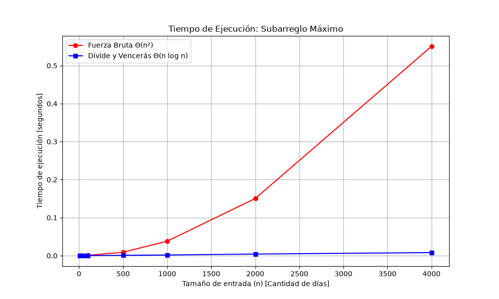

# Laboratorio Evaluativo 02 — Dividir y vencer

**Autor:** Cristian Jose Mendez Guzman  
**Fecha:** Octubre 2026

---

## 1. Instrucciones de Reproducción

Para ejecutar los experimentos y generar la gráfica desde la carpeta del laboratorio:

1. **Activar el entorno virtual** (desde la raíz del repositorio): `..\..\venv\Scripts\activate`
2. **Navegar al laboratorio**: `cd laboratorios/lab2-divide-y-vencer`
3. **Ejecutar casos de prueba (sin output de error significa éxito)**: `python pruebas.py`
4. **Ejecutar mediciones y generar gráfica**: `python medicion.py`

---

## Parte 1 — Verificación de las soluciones

**Enlaces al código:** [subarreglo.py](subarreglo.py) | [pruebas.py](pruebas.py)

Para verificar las soluciones usé `assert` en Python. Evalué casos límite: la lista del problema de la gerente (dio 17), una lista de tamaño 1, un caso con solo números negativos, otro con solo positivos y un caso donde la mejor racha obligatoriamente cruza la mitad. Finalmente, validé con un ciclo `for` de 20 listas aleatorias (de tamaño y valores variables) comprobando que tanto la fuerza bruta como divide y vencerás devolvieran siempre la misma suma.

---

## Parte 2 — Medición y Gráfica

**Enlace al código:** [medicion.py](medicion.py)

---

## Parte 3 — Análisis 

### 1. Recurrencia
En el algoritmo de divide y vencerás, dividimos el arreglo en $a=2$ mitades, cada una de tamaño $n/2$ ($b=2$). Luego, el caso cruzado hace un barrido lineal desde el centro hacia los lados para encontrar la mejor racha que junta ambas mitades, costando $f(n) = \Theta(n)$. La recurrencia queda:

$$T(n) = 2T(n/2) + \Theta(n)$$

Resolviendo con el método maestro, calculamos $n^{\log_2 2} = n^1 = n$. Como $f(n) = \Theta(n)$ crece igual que $n^1$, estamos en el **Caso 2**, lo que nos da **$\Theta(n \log n)$**. 
Por otro lado, la fuerza bruta es **$\Theta(n^2)$** porque utiliza dos ciclos anidados: elige un día de inicio y luego recorre el resto de los días sumando paso a paso, probando todos los pares posibles.

### 2. Lo medido contra lo esperado
Mirando la gráfica, la curva de la fuerza bruta (roja) se dispara hacia arriba formando una parábola, lo que confirma su crecimiento cuadrático $\Theta(n^2)$. La de divide y vencerás (azul) se mantiene casi plana pegada al eje, confirmando su crecimiento $\Theta(n \log n)$. 
Si tomamos dos tamaños que se duplican, como $n=2000$ y $n=4000$, el tiempo de la fuerza bruta se multiplica por casi 4 veces (lo que concuerda con $(2n)^2 = 4n^2$). En cambio, el de divide y vencerás apenas se multiplica por poco más de 2 veces.

### 3. Tamaños pequeños
Sí, divide y vencerás empieza a ganar ventaja más o menos a partir de $n=50$ a $n=100$. En tamaños muy pequeños (como $n=10$), la fuerza bruta fue un poco más rápida. Esto pasa porque la recursión tiene un costo oculto (*overhead*): dividir y llamar funciones a memoria toma más tiempo inicial que un simple ciclo `for`, pero en cuanto los datos crecen, ese costo queda enterrado por la eficiencia matemática del algoritmo.

### 4. ¿Cuándo conviene dividir?
Dividir no siempre es mágico. Si el problema fuera solo hallar el máximo número de un arreglo, dividir por la mitad daría $T(n) = 2T(n/2) + \Theta(1)$, porque combinar las mitades sería solo comparar dos números. Por el método maestro (Caso 1), esto da $\Theta(n)$. Como recorrer la lista de forma normal con un ciclo ya toma $\Theta(n)$, dividir este problema no aporta absolutamente ninguna mejora en el tiempo y solo nos hace gastar memoria en recursión. Solo conviene dividir si el costo de "combinar" es bajo comparado con lo que ahorras al no hacer fuerza bruta.

### 5. Concepto para la gerente
Recomiendo implementar el algoritmo de **Divide y Vencerás**. 
*Estimación matemática:* Para 1.000.000 de registros en sensores, asumiendo (a modo de ejemplo) que para $n=4000$ la fuerza bruta tardó $0.5$ segundos, al escalar $250$ veces más grande ($1.000.000 / 4000 = 250$), el tiempo crece de forma cuadrática ($250^2 = 62.500$). Tardaría unas **~8.6 horas**. 
En cambio, con divide y vencerás creciendo de forma $n \log n$, procesar ese millón de datos tomará **menos de 3 segundos**. Es una estimación basada en la forma de la curva y no una prueba real, pero demuestra que la fuerza bruta es inútil para la analítica de la cooperativa.